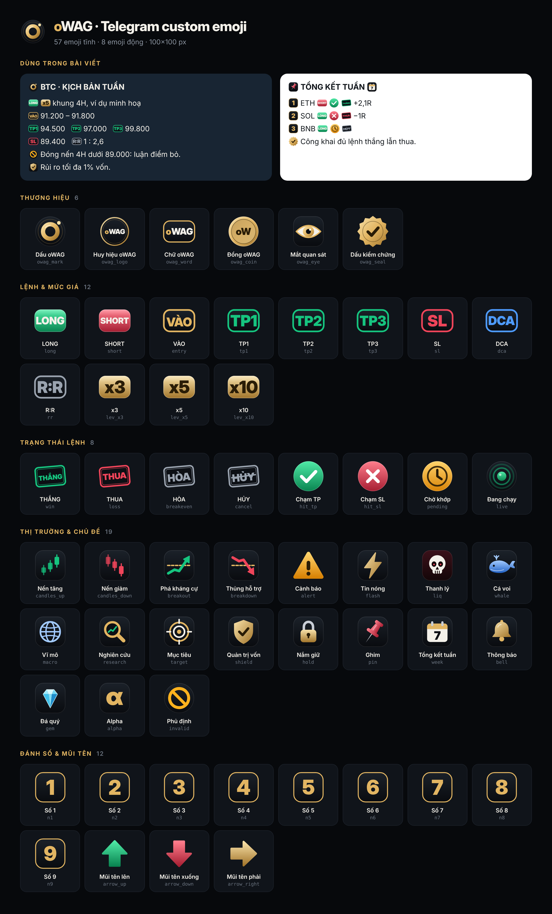
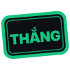
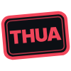
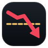
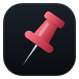

# oWAG · bộ emoji Telegram

57 emoji tĩnh, 8 emoji động, chuẩn emoji tuỳ chỉnh của Telegram (100×100 px).
Thiết kế cho kênh giao dịch: nhãn lệnh, mức giá, trạng thái, chủ đề thị trường, đánh số.



## Hệ thống thiết kế

- **Viên đặc** = chiều lệnh và đòn bẩy: LONG, SHORT, x3, x5, x10.
- **Viên viền** = mức giá: VÀO, TP1–TP3, SL, DCA, R:R.
- **Con dấu nghiêng** = kết quả cho bản tổng kết tuần: THẮNG, THUA, HÒA, HỦY.
- **Ô vuông mực** = chủ đề thị trường. **Đĩa tròn** = trạng thái lệnh.
- Màu: đen mực làm nền, vàng sâm panh là màu thương hiệu, xanh = tăng, đỏ = giảm, hổ phách = cảnh báo.

## Tệp

| Thư mục | Nội dung |
|---|---|
| `dist/static/` | PNG 100×100 nền trong suốt, tải thẳng lên Telegram |
| `dist/video/` | WEBM VP9 100×100, 2 giây, 30 khung/giây, nền trong suốt, mỗi tệp dưới 16 KB |
| `dist/svg/` | Bản vector để sửa trên Figma/Illustrator (font: Inter Display Black) |
| `dist/manifest.json` | Danh sách mã, emoji gắn kèm, từ khoá tìm kiếm |
| `dist/owag-emoji.zip` | Toàn bộ các thứ trên |

## Cách 1 · Tải lên tự động (khuyên dùng)

Không phải gửi tay 57 tệp. Cần Python 3, không cần cài thêm thư viện.

1. Tạo bot qua **@BotFather** → lấy token.
2. Lấy ID số của tài khoản sẽ sở hữu bộ emoji (qua **@userinfobot**).
3. Nhắn `/start` cho bot vừa tạo. Bỏ bước này Telegram sẽ báo lỗi người dùng.
4. Chạy:

```bash
export TELEGRAM_BOT_TOKEN="123456:ABC..."
python3 upload/upload_pack.py --user-id 123456789
```

Kết quả: đường dẫn `https://t.me/addemoji/owag_by_<tên_bot>`. Bộ thuộc về tài khoản của bạn, quản lý tiếp qua **@Stickers**.

Chế độ:
- `--mode mixed` (mặc định): một bộ, 8 emoji có bản động dùng WEBM, còn lại PNG.
- `--mode static`: toàn bộ PNG tĩnh. Dùng nếu Telegram từ chối bộ trộn định dạng.
- `--mode video`: chỉ 8 emoji động, để làm một bộ riêng (thêm `--name owag_motion`).
- `--dry-run`: in danh sách, không gửi gì.

## Cách 2 · Thủ công qua @Stickers

1. Nhắn **@Stickers** → `/newemojipack` → chọn **Static emoji** (hoặc **Video emoji** cho thư mục `video/`).
2. Đặt tên bộ: `oWAG`.
3. Gửi từng tệp trong `dist/static/` **dạng tệp (File)**, không gửi dạng ảnh. Sau mỗi tệp, gửi emoji gắn kèm (xem cột emoji trong `manifest.json`).
4. `/publish` → chọn biểu tượng bộ (`owag_mark`) → đặt tên ngắn, ví dụ `owag`.

Emoji gắn kèm chỉ dùng để Telegram gợi ý khi gõ, không xuất hiện trong bài.

## Lưu ý khi dùng

- Muốn chèn emoji tuỳ chỉnh vào bài, tài khoản đăng bài cần Telegram Premium. Người đọc không cần Premium vẫn thấy.
- Nhóm đạt mức boost đủ cao có thể đặt một bộ emoji cho cả nhóm dùng, kể cả thành viên không có Premium. Kiểm tra trong phần cài đặt nhóm.
- Nhãn chữ (LONG, SHORT, THẮNG…) đọc rõ trên điện thoại. Trên máy tính, emoji hiện nhỏ hơn, nên đặt cạnh số liệu thay vì để đứng một mình.

## Sửa và dựng lại

Màu nằm ở bảng `C` đầu tệp `src/emoji.mjs`. Đổi màu, sửa hình, thêm emoji ngay trong tệp đó, rồi chạy:

```bash
node src/build.mjs
```

Cần Node 18+, Playwright có Chromium, ffmpeg có libvpx-vp9 và font Inter Display.

## Danh sách

### Thương hiệu (6)

| Emoji | Mã | Dùng khi | Động |
|---|---|---|---|
|  | `owag_mark` | Mở đầu bài, chữ ký cuối bài | có |
|  | `owag_logo` | Đầu tiêu đề, ảnh đại diện mini |  |
|  | `owag_word` | Chèn tên thương hiệu trong câu |  |
|  | `owag_coin` | Nói về token, phần thưởng cộng đồng |  |
|  | `owag_eye` | Đang theo dõi, chờ xác nhận | có |
|  | `owag_seal` | Số liệu đã kiểm chứng, lệnh công khai |  |

### Lệnh & mức giá (12)

| Emoji | Mã | Dùng khi | Động |
|---|---|---|---|
|  | `long` | Chiều mua | có |
|  | `short` | Chiều bán | có |
|  | `entry` | Vùng vào lệnh |  |
|  | `tp1` | Mục tiêu chốt lời 1 |  |
|  | `tp2` | Mục tiêu chốt lời 2 |  |
|  | `tp3` | Mục tiêu chốt lời 3 |  |
|  | `sl` | Điểm cắt lỗ |  |
|  | `dca` | Vùng trung bình giá |  |
|  | `rr` | Tỷ lệ lời/lỗ của kịch bản |  |
|  | `lev_x3` | Đòn bẩy x3 |  |
|  | `lev_x5` | Đòn bẩy x5 |  |
|  | `lev_x10` | Đòn bẩy x10 |  |

### Trạng thái lệnh (8)

| Emoji | Mã | Dùng khi | Động |
|---|---|---|---|
|  | `win` | Tổng kết: lệnh thắng |  |
|  | `loss` | Tổng kết: lệnh thua |  |
|  | `breakeven` | Tổng kết: hoà vốn |  |
|  | `cancel` | Kịch bản bị huỷ, không khớp |  |
|  | `hit_tp` | Đã chạm mục tiêu | có |
|  | `hit_sl` | Đã dính cắt lỗ |  |
|  | `pending` | Lệnh chờ, chưa khớp |  |
|  | `live` | Lệnh đang mở | có |

### Thị trường & chủ đề (19)

| Emoji | Mã | Dùng khi | Động |
|---|---|---|---|
|  | `candles_up` | Xu hướng tăng |  |
|  | `candles_down` | Xu hướng giảm |  |
|  | `breakout` | Breakout |  |
|  | `breakdown` | Breakdown |  |
|  | `alert` | Rủi ro, tin xấu, cẩn trọng | có |
|  | `flash` | Tin nhanh, biến động mạnh | có |
|  | `liq` | Cháy tài khoản, thanh lý hàng loạt |  |
|  | `whale` | Ví lớn, dòng tiền lớn |  |
|  | `macro` | Tin vĩ mô, lãi suất, dòng vốn toàn cầu |  |
|  | `research` | Bóc tách dự án, bài phân tích |  |
|  | `target` | Vùng giá mục tiêu |  |
|  | `shield` | Quản trị rủi ro, bảo toàn vốn |  |
|  | `hold` | Vị thế dài hạn, khoá vốn |  |
|  | `pin` | Bài ghim, tổng kết tuần |  |
|  | `week` | Bản tổng kết 7 ngày |  |
|  | `bell` | Báo động giá, nhắc lịch |  |
|  | `gem` | Đồng tiền tiềm năng |  |
|  | `alpha` | Góc nhìn riêng, thông tin sớm |  |
|  | `invalid` | Điều kiện phủ định luận điểm |  |

### Đánh số & mũi tên (12)

| Emoji | Mã | Dùng khi | Động |
|---|---|---|---|
|  | `n1` | Đánh số ý trong bài |  |
|  | `n2` | Đánh số ý trong bài |  |
|  | `n3` | Đánh số ý trong bài |  |
|  | `n4` | Đánh số ý trong bài |  |
|  | `n5` | Đánh số ý trong bài |  |
|  | `n6` | Đánh số ý trong bài |  |
|  | `n7` | Đánh số ý trong bài |  |
|  | `n8` | Đánh số ý trong bài |  |
|  | `n9` | Đánh số ý trong bài |  |
|  | `arrow_up` | Tăng, vượt |  |
|  | `arrow_down` | Giảm, thủng |  |
|  | `arrow_right` | Gạch đầu dòng, dẫn ý |  |
